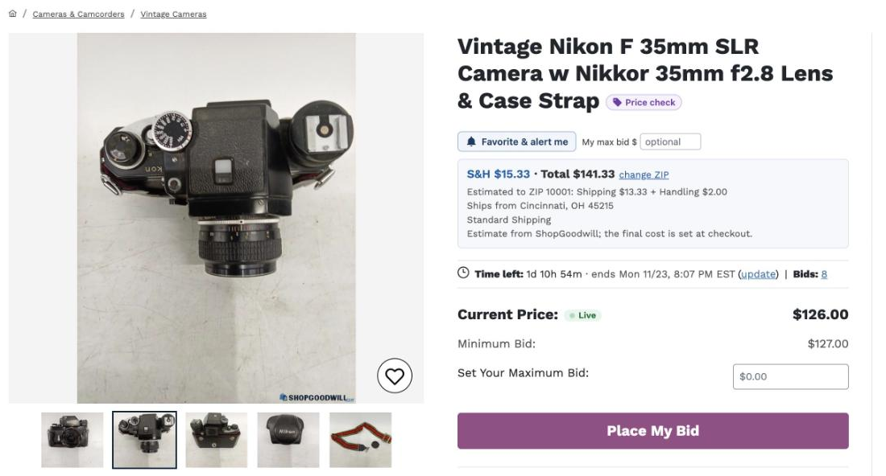
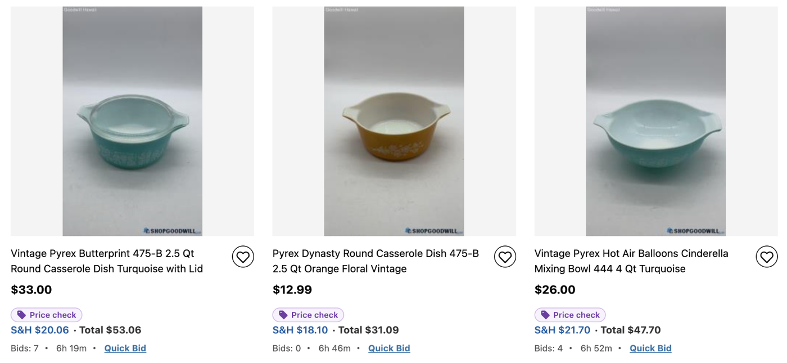
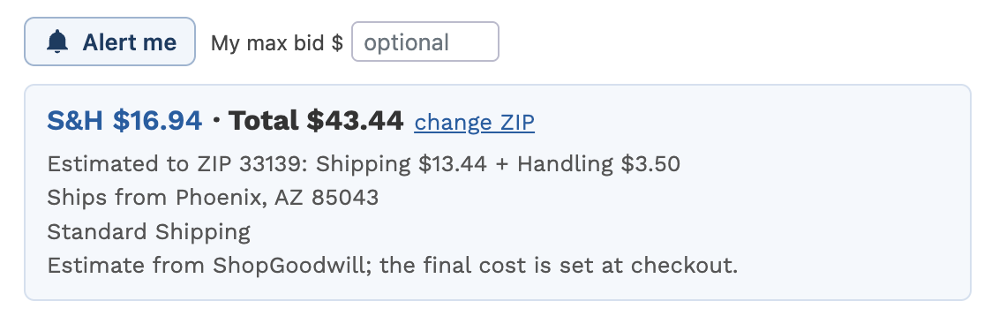
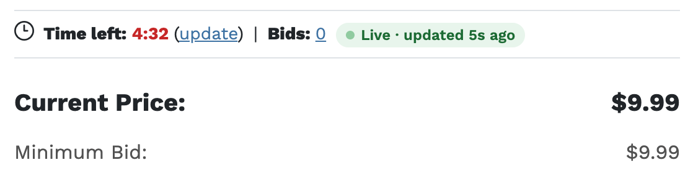
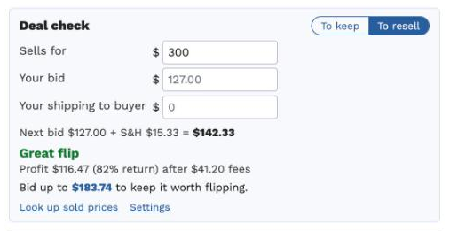
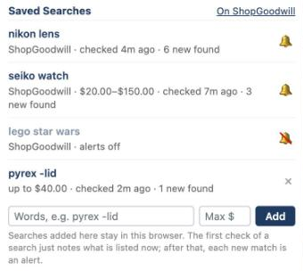
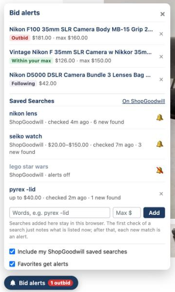
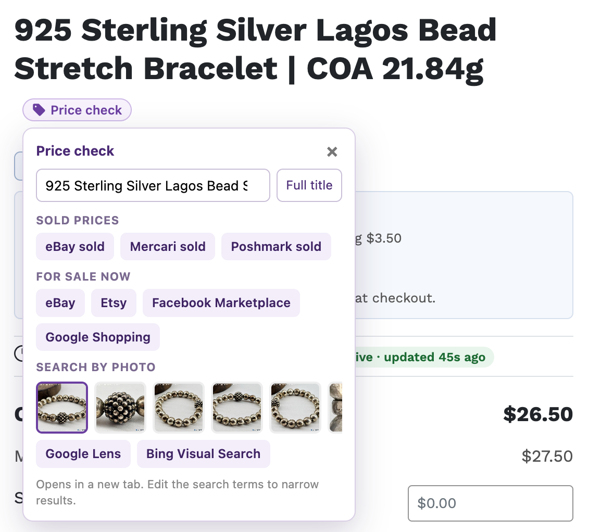
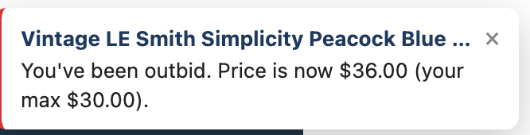
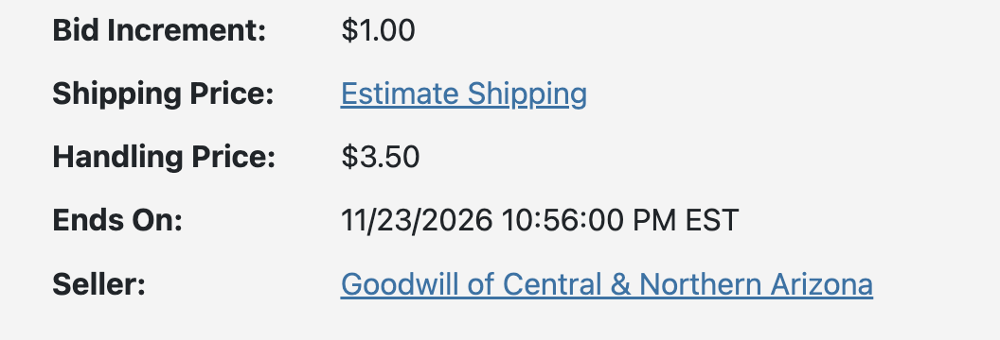

<p align="center">
  <strong>Open-source browser tools and enhancements for ShopGoodwill.com</strong>
</p>

<p align="center">
  <a href="https://github.com/maxhayim/shopgoodwill.com-tools/actions/workflows/validate.yml">
    
  </a>
  <a href="https://github.com/maxhayim/shopgoodwill.com-tools/releases/latest">
    
  </a>
  <a href="https://opensource.org/licenses/MIT">
    
  </a>
  
</p>

# shopgoodwill.com tools

**shopgoodwill.com tools** is a set of small, independent browser userscripts that make ShopGoodwill.com easier to bid on: ending times in your time zone, what an item will really cost delivered, whether it's worth that price, an auction page that keeps itself up to date, alerts when you're outbid or when new listings match your saved searches, and one-click price checks before you bid.

Each tool is a single file in [`scripts/`](scripts/). Install only the ones you want. They work on desktop and on phones, including iPhone Safari (see [Installation](#installation)).

| Tool | What it does | Install |
|---|---|---|
| **Local Time** | Shows auction ending times in your time zone, detected automatically, or any zone you pick | [Install](https://raw.githubusercontent.com/maxhayim/shopgoodwill.com-tools/main/scripts/shopgoodwill-local-time.user.js) |
| **Shipping & Handling** | Estimated shipping & handling and the total cost for your ZIP code, on search results and item pages | [Install](https://raw.githubusercontent.com/maxhayim/shopgoodwill.com-tools/main/scripts/shopgoodwill-shipping.user.js) |
| **Live Auction** | Keeps the price, bids and a to-the-second countdown up to date on item pages, and in the tab title | [Install](https://raw.githubusercontent.com/maxhayim/shopgoodwill.com-tools/main/scripts/shopgoodwill-live-auction.user.js) |
| **Price Check** | One click to sold prices, current listings and search-by-photo on other marketplaces | [Install](https://raw.githubusercontent.com/maxhayim/shopgoodwill.com-tools/main/scripts/shopgoodwill-price-check.user.js) |
| **Deal Check** | Adds up the next bid, shipping and tax, says whether the item is worth it to keep or to resell, and shows the most to bid | [Install](https://raw.githubusercontent.com/maxhayim/shopgoodwill.com-tools/main/scripts/shopgoodwill-deal-check.user.js) |
| **Bid Alerts** | Pop-up, sound and desktop alerts when you're outbid, when someone bids on an item you follow, before auctions end, and when new listings match your saved searches (synced with ShopGoodwill's). Favoriting an item turns its alerts on | [Install](https://raw.githubusercontent.com/maxhayim/shopgoodwill.com-tools/main/scripts/shopgoodwill-bid-alerts.user.js) |

The tools don't depend on each other and work together on the same page.

<h2>Screenshots</h2>

<p align="center">
  
  <br><em>An item page with Price Check, Bid Alerts, Shipping & Handling, Live Auction, Local Time and Deal Check</em>
</p>

<p align="center">
  
  <br><em>Shipping & Handling on search results: S&H and the total for your ZIP code</em>
</p>

<table>
  <tr>
    <td width="50%"><br><em>Shipping & Handling on an item page</em></td>
    <td width="50%"><br><em>Live Auction countdown with the local end time beside it</em></td>
  </tr>
  <tr>
    <td><br><em>Deal Check: is it worth the price?</em></td>
    <td><br><em>Saved Searches, synced with ShopGoodwill</em></td>
  </tr>
  <tr>
    <td><br><em>Bid Alerts overview</em></td>
    <td><br><em>Price Check</em></td>
  </tr>
  <tr>
    <td><br><em>An outbid alert</em></td>
    <td><br><em>Local Time on the item page's Ends On line (Eastern shown)</em></td>
  </tr>
</table>

<sub>Screenshots from shopgoodwill.com, taken 2026-11-18 to 2026-11-22 with a demo ZIP code and example saved searches. Listings and photos belong to their sellers.</sub>

## Features

### Local Time

*Formerly Eastern Time. Existing installs update to it automatically.*

- Converts auction ending times from ShopGoodwill's Pacific Time to **your device's time zone**, detected automatically: `6:39:00 PM PDT` becomes `9:39:00 PM EDT` in New York, `8:39:00 PM CDT` in Chicago, `3:39:00 PM HST` in Honolulu.
- Works with **every time zone** your browser knows (more than 400), in the US and abroad. To use a different one, tap or click the end time next to **Time left** on any item page and pick a zone. The choice is saved; pick **Automatic** to follow the device again.
- Shows standard or daylight time correctly (EST/EDT, CST/CDT, MST, AKST/AKDT, HST...), including on the nights the clocks change.
- Uses the auction's closing date when it is on the page, never today's date.
- Handles times that cross midnight, for example `10:30:00 PM PST` → `1:30:00 AM EST (next day)`.
- Keeps the original Pacific time in a tooltip: hover over a converted time to see it.
- On item pages, shows the end time in your time zone right beside the countdown: **Time left: 5h 18m · ends Thu 11/19, 9:02 PM EST**.
- Also converts the item page's **Ends On** line (`11/23/2026 07:56:00 PM PT` → `11/23/2026 10:56:00 PM EST`), using its date for standard/daylight time.
- Works on pages Angular loads or redraws after the page opens (search results, paging, item pages).
- Converts each time once, and converts again only if the site puts a new Pacific time in its place.
- Leaves countdown timers, prices, bid buttons and everything else alone.
- Light on phone batteries: countdown ticks don't trigger rescans; only new Pacific times do.
- Plain JavaScript: no jQuery, no frameworks, no network requests, no permissions (`@grant none`).

### Shipping & Handling

- Adds a line under every search result price: **S&H $15.20 · Total $35.19**. The total is the current price plus shipping and handling.
- On item pages, a box above the bidding panel shows the breakdown: shipping, handling, where it ships from and the carrier service.
- Pickup-only items say so, with the pickup city: **Pickup · Newark, OH**. Any handling fee is included in the total.
- Estimates come from ShopGoodwill's own shipping calculator (the one behind *Estimate Shipping* on item pages), so they match what the site would tell you.
- Set your ZIP code once (click **set ZIP for estimate** or **change ZIP**). It is saved in your browser only.
- Only results you scroll to are estimated, at most two requests at a time, and results are remembered for six hours, so browsing stays fast and light on ShopGoodwill.
- Works in grid and list view and keeps up when you search, filter or change pages.

### Live Auction

- **Time left** becomes a countdown that ticks every second (`1:45:41`), turning red in the last five minutes.
- The current price, bid count and minimum bid refresh on their own, and briefly highlight when they change.
- A **Live** chip beside **Current Price** shows the updates are on; hover it to see when the page last checked. Click it to pause or resume.
- The browser tab title shows the countdown and price (`⏱ 1:45:41 · $19.99 | …`), so you can follow an auction from another tab.
- Checks more often as the end gets closer (every minute when days are left, every 4 seconds in the final 2 minutes), slows down while the tab is in the background, and stops when the auction ends.
- The countdown uses ShopGoodwill's server clock, so it's right even if your computer's clock is off.
- Display only: it never places, changes or confirms a bid.

### Price Check

- Adds a **Price check** button next to the item title and under every search result price.
- Opens a panel with search terms tidied up from the listing title (seller notes after `|`, weights such as `21.84g`, and words like *untested* or *lot of* are dropped). Edit them, or click **Full title** to use the original.
- **Sold prices:** eBay sold, Mercari sold, Poshmark sold.
- **For sale now:** eBay, Etsy, Facebook Marketplace, Google Shopping.
- **Search by photo:** pick any of the item's photos, then search with Google Lens or Bing Visual Search.
- Links open in a new tab. Nothing is fetched from those sites, and nothing about you is sent to them beyond the search itself.

### Deal Check

- A **Deal check** box under the bidding panel on every item page answers "is this worth it?".
- **To keep:** enter what the item is worth to you. **To resell:** enter what it sells for (use **Look up sold prices**), plus what you'd pay to ship it to your buyer.
- Adds up what you'd really pay: the next bid (or Buy It Now price) + shipping & handling to your ZIP code + your sales tax: **Next bid $122.00 + S&H $13.47 = $135.47**.
- Gives a verdict:
  - To keep: **Great deal** (you pay 70% of its worth or less), **Good deal** (up to 90%), **Fair price** (up to 100%), **Not worth it**.
  - To resell: **Great flip**, **Worth flipping** (at least $10 profit and a 30% return, both adjustable), **Thin margin**, **Would lose money**. Selling fees are taken off first (13.6% + $0.40 a sale by default; change them in **Settings**).
- Shows the most you can bid and still have a good deal: **Bid up to $166.53 to keep it a good deal**. Enter **Your bid** to see the verdict for a bid you have in mind.
- Keeps the price current while the page is open, and remembers what you entered for each item for 60 days.
- Shares the ZIP code with Shipping & Handling, so you enter it once.
- **Look up sold prices** opens the Price Check panel if that tool is installed, otherwise eBay's sold listings for the item's title in a new tab.

### Bid Alerts

- **Outbid:** alerts as soon as the price passes your max bid. If a bid reaches your max exactly, you get a separate "may be outbid" warning, because the earlier bidder wins a tie.
- **New bid:** someone bid on an item you follow.
- **Ending soon:** 15, 5 and 1 minute(s) before the end (you choose the minutes).
- **Ended:** the final price, and whether it was within your max.
- **Bids you place are followed automatically.** When ShopGoodwill confirms a bid in this browser, the script notes the item and your max. It only reads the site's reply; it never places, changes or repeats a bid.
- **Follow anything else** with **Alert me** on an item page. Optionally enter your max bid there, for example for bids placed on your phone.
- **Favorites and alerts go together.** Favorite an item with ShopGoodwill's heart (on an item page or in search results) and its alerts turn on; un-favorite it and they turn off (alerts for your own bids stay). When you're signed in, the button reads **Favorite & alert me** and does both. Turn this off with **Favorites get alerts** in the settings.
- **Saved Searches:** get an alert when a new listing matches one of your saved searches. The saved searches on your ShopGoodwill account (**My ShopGoodwill → Saved Searches**) are included automatically while you're signed in, with their price range, category and seller, and stay in sync: save or delete one on ShopGoodwill and the list follows. The bell beside each one turns its alerts off and on. You can also add searches just for this browser, such as `casio g-shock` with a highest price; put `-` before words to skip, e.g. `pyrex -lid -parts`. Searches run every 10 minutes (adjustable), newest listings first; the first check only notes what is already listed. Several new matches at once are grouped into one alert that opens the results.
- Alerts show as pop-ups on every open ShopGoodwill tab, with an optional sound and optional desktop notifications. Only one tab checks prices, so you don't get the same alert in every tab.
- A **Bid alerts** button (bottom left) shows how many auctions you follow, turns red with the number you're outbid on, and opens a list with each item's status and the settings.
- Checks every 5 minutes when days are left, down to every 5 seconds in the last 3 minutes. Ended auctions drop off the list after a day.

## Requirements

- A browser with a userscript manager. [Tampermonkey](https://www.tampermonkey.net/) is the one this project targets:
  - **Desktop:** Chrome, Edge, Firefox or Safari.
  - **iPhone and iPad:** Safari with the Tampermonkey Safari extension (iOS 15 or newer).
  - **Android:** Firefox with the Tampermonkey add-on.

## Privacy

- The tools run only on `shopgoodwill.com` and `www.shopgoodwill.com`.
- Shipping & Handling, Live Auction, Deal Check and Bid Alerts talk only to ShopGoodwill's own API (`buyerapi.shopgoodwill.com`), the same one the site uses. Your ZIP code goes there and nowhere else.
- Bid Alerts reads prices from the public item details everyone sees, and searches the same public listings as the site's search box. To read your saved searches list, it reuses the sign-in the page itself just sent to ShopGoodwill, only for that one request to ShopGoodwill's own API; it is kept in the page's memory and never stored or sent anywhere else. It never sees your password. The only thing it does on your account is press ShopGoodwill's own favorite heart when you click **Favorite & alert me**; it never creates, changes or deletes saved searches.
- Your ZIP code, cached estimates, followed auctions, saved searches, alert settings, Deal Check values and settings, and chosen time zone are kept in your browser's storage for shopgoodwill.com, under keys starting with `sgwTools.`.
- No accounts, analytics, tracking or third-party servers.

## Installation

### Desktop

1. Install the Tampermonkey extension for your browser:
   - [Chrome](https://chromewebstore.google.com/detail/tampermonkey/dhdgffkkebhmkfjojejmpbldmpobfkfo)
   - [Firefox](https://addons.mozilla.org/firefox/addon/tampermonkey/)
   - [Edge](https://microsoftedge.microsoft.com/addons/detail/tampermonkey/iikmkjmpaadaobahmlepeloendndfphd)
   - [Safari](https://www.tampermonkey.net/?browser=safari)
2. In Chrome and Edge, allow userscripts: open the extension's details page and turn on **Allow User Scripts** (or **Developer mode** on older versions).
3. Open the install link for each tool you want:
   - **[Local Time](https://raw.githubusercontent.com/maxhayim/shopgoodwill.com-tools/main/scripts/shopgoodwill-local-time.user.js)**
   - **[Shipping & Handling](https://raw.githubusercontent.com/maxhayim/shopgoodwill.com-tools/main/scripts/shopgoodwill-shipping.user.js)**
   - **[Live Auction](https://raw.githubusercontent.com/maxhayim/shopgoodwill.com-tools/main/scripts/shopgoodwill-live-auction.user.js)**
   - **[Price Check](https://raw.githubusercontent.com/maxhayim/shopgoodwill.com-tools/main/scripts/shopgoodwill-price-check.user.js)**
   - **[Bid Alerts](https://raw.githubusercontent.com/maxhayim/shopgoodwill.com-tools/main/scripts/shopgoodwill-bid-alerts.user.js)**
4. Tampermonkey shows an install page for each. Click **Install**.
5. Open or reload [shopgoodwill.com](https://shopgoodwill.com/).
6. For shipping estimates, click **set ZIP for estimate** under any search result and enter your ZIP code.
7. For desktop notifications, open **Bid alerts** (bottom left), tick **Desktop notifications** and allow them when the browser asks.

### iPhone and iPad (Safari)

1. Install **Tampermonkey** for Safari from the App Store ([details](https://www.tampermonkey.net/?browser=safari)).
2. Turn it on: **Settings → Apps → Safari → Extensions → Tampermonkey** (on iOS 17 and earlier, **Settings → Safari → Extensions**). Switch it on and allow it on **shopgoodwill.com** and **raw.githubusercontent.com** (where the install links point), or on **All Websites**.
3. In Safari, open the install link for each tool you want (the same links as above, for example **[Local Time](https://raw.githubusercontent.com/maxhayim/shopgoodwill.com-tools/main/scripts/shopgoodwill-local-time.user.js)**). Tampermonkey shows its install page; tap **Install**. If you only see the script's text, tap the extensions button in the address bar (**aA** or the puzzle piece), choose **Tampermonkey**, and install from there.
4. Open [shopgoodwill.com](https://shopgoodwill.com/) normally. There's no need to request the desktop site.

On iPhone:
- Times use the phone's time zone (**Settings → General → Date & Time**). Tap the end time on an item page to pick another.
- Tap where you would hover on a computer: the end time opens the time zone picker, and the item page's shipping box shows the full breakdown.
- Bid Alerts shows pop-ups and plays sounds while Safari has a ShopGoodwill tab open in front. iOS pauses background tabs, so alerts catch up when you return. Safari on iPhone has no desktop notifications for websites, so that setting is hidden there.

The free [Userscripts](https://github.com/quoid/userscripts) Safari extension should also run these scripts (they need no special permissions), but it hasn't been tested.

### Android (Firefox)

1. Install [Firefox for Android](https://play.google.com/store/apps/details?id=org.mozilla.firefox), then add [Tampermonkey](https://addons.mozilla.org/android/addon/tampermonkey/) from Firefox's add-ons menu.
2. Open the install links above in Firefox and tap **Install**.

## Usage

- **Local Time:** nothing to set up. Ending times appear in your device's time zone. Hover over a time to see the original Pacific time. To change the zone, click or tap the end time next to **Time left** on an item page.
- **Shipping & Handling:** set your ZIP code once. Hover over an estimate for the breakdown.
- **Live Auction:** open any item page. Click the **Live** chip to pause or resume updates.
- **Price Check:** click **Price check**, adjust the search terms if needed, then click a marketplace. Press <kbd>Enter</kbd> to open the first link, <kbd>Esc</kbd> to close.
- **Deal Check:** on an item page, enter what the item is worth to you (or pick **To resell** and enter what it sells for). Open **Settings** once to add your sales tax and ZIP code.
- **Bid Alerts:** bid as usual; the item is followed automatically. To follow something else, favorite it or click **Alert me** on its page. For new listing alerts, save searches on ShopGoodwill as usual; they show up under **Saved Searches** in the **Bid alerts** panel. To add one only here, type your words there and click **Add** (on a search results page, your search words are filled in). Keep at least one ShopGoodwill tab open to get alerts.

### Local Time examples

In New York (Eastern):

| ShopGoodwill shows | Closing date known? | You see |
|---|---|---|
| `6:39:00 PM PDT` | no | `9:39:00 PM EDT` |
| `4:05:00 PM PST` | no | `7:05:00 PM EST` |
| `12:00:00 PM PDT` | no | `3:00:00 PM EDT` |
| `9:00:00 PM PST` | no | `12:00:00 AM EST (next day)` |
| `11:30:00 PM PDT` | no | `2:30:00 AM ET (next day)` |
| `8/31/2026 10:30:00 PM PDT` | yes, in the text | `9/1/2026 1:30:00 AM EDT` |
| `11:30:00 PM PST` on 3/7/2026 | yes, nearby | `3:30:00 AM EDT (next day)` |
| `11:30:00 PM PDT` on 10/31/2026 | yes, nearby | `1:30:00 AM EST (next day)` |

## How It Works

### Local Time

The zone comes from the browser (`Intl.DateTimeFormat().resolvedOptions().timeZone`) unless you picked one; your choice is kept in `localStorage` under `sgwTools.time.zone`.

The script looks for elements matching `li.text-danger`, and for the value next to labels such as **Ends On:**, whose text contains a time ending in `PDT`, `PST` or `PT`. It replaces just that time in the element's text and remembers what it wrote, so the next scan skips it. It keeps the original Pacific text in a `data-sgw-et-source` attribute. A `MutationObserver` watches for Angular adding or redrawing content and triggers a rescan (debounced, so a burst of changes causes one scan). Text changes that hold no Pacific time, such as a ticking countdown, are ignored.

#### Daylight saving time

For zones that keep Eastern time (New York, Toronto, Detroit...), the script uses its own Eastern rules, described below. Every other zone is converted through the browser's time zone database (`Intl.DateTimeFormat`), which knows each zone's rules, including countries that change clocks on different dates. When the closing date isn't on the page, today's date (Pacific) is used, which only matters around a clock change; the tooltip says so.

Pacific and Eastern Time are three hours apart almost all the time. The exception is the two nights a year the clocks change, because each zone changes at 2 AM *its own* local time:

- **Spring (2nd Sunday of March):** from 11 PM to 2 AM Pacific, Eastern is already on EDT while Pacific is still on PST, so the gap is **4 hours**.
- **Fall (1st Sunday of November):** from 11 PM to 2 AM Pacific, Eastern is already back on EST while Pacific is still on PDT, so the gap is **2 hours**.

When the auction's closing date is available, either in the same text as the time or in the same listing, the script works out the exact moment and gets these nights right.

When the date is **not** available, the script adds three hours, like the original script. If the time is between 2 AM and 11 PM Pacific and the site says `PDT` or `PST`, the result is exact and shown as `EDT` or `EST`. If the time is between 11 PM and 2 AM, or the site only says `PT`, the script shows the neutral `ET` and says in the tooltip that EST/EDT could not be confirmed.

The script uses the US daylight-saving rules in force since 2007. Its results were checked against the system time zone database for every half hour from 2025 to 2028.

### Shipping & Handling

For each item, the script reads the item's details from ShopGoodwill's API (`ItemDetail/GetItemDetailModelByItemId`) to get the current price and whether it is pickup only. For items that ship, it asks `ItemDetail/CalculateShipping` for your ZIP code and reads the shipping, handling and total from the answer. Search results are estimated when they scroll into view.

### Live Auction

On an item page, the script reads the same item details on a schedule, then updates the numbers next to the site's own **Time left**, **Bids**, **Current Price** and **Minimum Bid** labels. It finds them by their label text, not by class names, and changes only the text, never the bid form.

### Price Check

Search terms and links are built in the browser from the listing title. Photos come from the item's details. The list of marketplaces is the `SOURCES` table near the top of the script, so adding one is a one-line change.

### Deal Check

On an item page, the script reads the item's details from ShopGoodwill's API (`minimumBid` for the next bid, `currentPrice` once ended, the Buy It Now price for buy-now-only listings) and asks `ItemDetail/CalculateShipping` for your ZIP code, then does the arithmetic in the browser:

- **Total** = price + S&H + tax on both.
- **To keep:** total ÷ what it's worth to you sets the verdict.
- **To resell:** profit = sale price − selling fees − your shipping − total, and return = profit ÷ total.
- **Bid up to** works backwards from the "good" line: for To keep, 90% of the value; for To resell, the lower of (net sale − least profit) and (net sale ÷ (1 + least return)). It then takes off tax and S&H and rounds down to the cent.

The price is refreshed every minute while the tab is visible.

### Bid Alerts

The script keeps a list of followed auctions in your browser's storage. One open ShopGoodwill tab is chosen to do the checking. If it closes, another tab takes over within seconds. That tab reads each auction's public details and compares the price, bid count and end time with what it saw last time. Alerts are shared with the other tabs through browser storage.

To follow your own bids automatically, the script watches for the site's own `ItemBid/PlaceBid` request to finish. When the reply says the bid was accepted, it records the item and the amount. The request and reply are passed through untouched.

Outbid detection compares the price with your max bid. With proxy bidding, the price never goes past the highest bidder's max, so a price above your max means someone else's max is higher.

Favorites: the script listens for clicks on ShopGoodwill's heart buttons (`a.btn-heart`). Each heart names its item, and its label says whether the click adds or removes the favorite, so the script follows or stops following that item. **Favorite & alert me** follows the item and then presses the page's heart, if it isn't already a favorite. Nothing happens when you're signed out.

Saved Searches: when the site loads your saved searches (`SaveSearches/GetSaveSearches`), Bid Alerts reads the reply; every 30 minutes, while you're signed in, it asks for the list again with the sign-in header the page last used. Searches deleted on ShopGoodwill are dropped, repeats are listed once, and a search you'd added here with the same words keeps its history. The checking tab sends each search to `Search/ItemListing`, the same search the site uses, sorted **Newly Listed**, and compares the item numbers with the ones it saw before. Items it hasn't seen, listed no earlier than the newest one it already knew about (with a few hours' allowance), are new. Words starting with `-` are left out of the search and used to skip titles that contain them.

### Updating selectors

ShopGoodwill can change its markup at any time. Everything page-specific is in the `CONFIG` block at the top of each script. For example, in [`scripts/shopgoodwill-local-time.user.js`](scripts/shopgoodwill-local-time.user.js):

```javascript
var CONFIG = {
  timeSelectors: ['li.text-danger'],   // elements that hold the Pacific time
  dateSearchLevels: 2,                 // how far up to look for the closing date
  dateSearchMaxTextLength: 600,        // skip ancestors bigger than this
  rescanDelayMs: 150,                  // wait after page changes before rescanning
  attrPrefix: 'data-sgw-et'            // attributes used to remember conversions
};
```

The other scripts work the same way: Shipping & Handling and Price Check use `cardSelector`, `cardNameSelector` and `cardPriceSelector` for search results, and Live Auction uses `panelSelector` plus the `labels` it looks for.

If a tool stops working:

1. On ShopGoodwill, right-click the part of the page that changed and choose **Inspect**.
2. Note the element's tag and classes (for example `<li class="text-danger">`).
3. Update the matching selector in `CONFIG`. Keep selectors narrow so the tool stays away from unrelated parts of the page.
4. Run `npm test`, then open a pull request.

## Automatic Updates

Each script's `@updateURL` and `@downloadURL` point at its copy on the `main` branch. Tampermonkey checks it on its normal schedule (daily by default) and installs a new version when the `@version` number goes up. To check right away, open the Tampermonkey dashboard and choose **Check for userscript updates**.

Eastern Time was renamed **Local Time** in v2.0.0. Its old address (`shopgoodwill-eastern-time.user.js`) still serves the same script, so existing installs update to Local Time and then follow the new address.

## Browser Compatibility

The scripts use only standard JavaScript and browser features (`fetch`, `MutationObserver`, `IntersectionObserver`, `localStorage`, `Intl`) available in every current browser. They are written for Tampermonkey on desktop Chrome, Edge, Firefox and Safari, Safari on iPhone and iPad, and Firefox for Android. Other userscript managers (Violentmonkey, Greasemonkey 4, Userscripts for Safari) should work but have not been tested.

ShopGoodwill's phone layout uses the same page structure as the desktop one, so every tool works in Safari's normal mobile view. On phones:
- Text boxes use 16px text, so Safari doesn't zoom in when you tap them.
- Buttons get bigger tap targets.
- Floating panels stay clear of the iPhone home bar, fit narrow screens, and follow the light or dark appearance.
- The Bid alerts button shrinks to a bell and a count.
- The Price Check panel doesn't pop up the keyboard when it opens.

## Known Limitations

- The automated tests use a small stand-in DOM, not a real browser. Eastern Time and Shipping & Handling have been used on the live site with Tampermonkey. The other tools were checked by loading them into live ShopGoodwill pages in Chrome (see [CHANGELOG.md](CHANGELOG.md)).
- Mobile support was checked in desktop Chrome with ShopGoodwill's phone layout at iPhone width (390px). It has not yet been tried on a real iPhone or Android phone, or in Firefox or desktop Safari.
- The closing date is only used when it appears in the time's own text or in the same listing. If ShopGoodwill does not show it near the time, the script falls back as described above.
- For Eastern zones, the US daylight-saving rules from 2007 onward are built in; if Congress changes them, the script will need an update. Other zones follow the browser's own time zone data, which updates with the browser.
- Times change zone after a reload: picking a new zone reloads the page.
- The time zone picker is on item pages only. The choice applies everywhere on ShopGoodwill.
- Shipping estimates are for US ZIP codes only, and are estimates: ShopGoodwill sets the final cost at checkout. Combined shipping for several items won by the same buyer is not reflected.
- Live Auction updates the item page only, not the countdowns on search results.
- Deal Check's verdict is only as good as the value you enter. Tax is applied to the item and S&H at one rate; some states don't tax shipping. Resale fees are a single percentage plus a fixed fee, not any marketplace's full fee table.
- Saved searches are only read, never created or deleted here; manage them on ShopGoodwill. Searches added in the panel stay in this browser.
- Your ShopGoodwill saved searches sync once the site has made a signed-in request in that tab (any page you open while signed in does); until then the last synced list is used.
- Saved Searches look at the newest 40 matches on each check. Very broad words (for example `watch`) can get more than 40 new listings between checks; use more specific words or a highest price.
- Favoriting from the ShopGoodwill app or another browser doesn't turn alerts on here; only hearts clicked in this browser do.
- Price Check links depend on each marketplace's search address. If one changes, the link may open a general search page instead.
- Bid Alerts only runs while a ShopGoodwill tab is open, like any userscript. Close every tab and alerts stop until you open one again.
- Bid Alerts follows bids placed in this browser automatically. For bids placed elsewhere (phone, another computer), click **Alert me** and enter your max.
- Bid Alerts can't see the winner. "Within your max" and "you may have won" come from comparing prices; check My ShopGoodwill for the result. Automatic bid capture has not yet been checked with a real bid.
- Sound only plays after you've clicked somewhere on a ShopGoodwill page (a browser rule).

## Troubleshooting

| Problem | What to try |
|---|---|
| Times still show PDT/PST | Make sure the script is enabled in Tampermonkey and that the page address starts with `https://shopgoodwill.com` or `https://www.shopgoodwill.com`. Reload the page. |
| Chrome/Edge: script never runs | Turn on **Allow User Scripts** (or **Developer mode**) for Tampermonkey, then reload. |
| Some times convert, others don't | ShopGoodwill may show those times in a different element. See [Updating selectors](#updating-selectors) and open an issue with the element's HTML. |
| A time shows `ET` instead of `EST`/`EDT` | The closing date wasn't found and the time is between 11 PM and 2 AM Pacific. Hover for details. The time itself is still three hours ahead of Pacific. |
| Want the original time | Hover over the converted time. On a phone, the item page's **Ends On** time and the picker show the zone in use. |
| Times are in the wrong time zone | Tap or click the end time next to **Time left** on an item page and pick your zone, or **Automatic** to use the device's. On iPhone, check **Settings → General → Date & Time**. |
| iPhone: nothing changes on ShopGoodwill | In **Settings → Apps → Safari → Extensions → Tampermonkey**, make sure it's on and allowed for shopgoodwill.com. Then reload the page. |
| Shipping shows **S&H unavailable** | Hover for ShopGoodwill's reason. Check your ZIP code with **change ZIP**. Some items can't be shipped to every ZIP code. |
| Shipping estimates look out of date | Estimates are kept for six hours. Changing the ZIP code fetches new ones. |
| The tab title keeps showing ⏱ | That's Live Auction following the item. Click the **Live** chip to pause it, or leave the item page. |
| Price Check opens the wrong item | Edit the search terms in the panel, or click **Full title**. |
| No bid alerts | Keep a ShopGoodwill tab open. Check that the item is in the **Bid alerts** list. |
| My ShopGoodwill saved searches don't show | Sign in and open any ShopGoodwill page (or **My ShopGoodwill → Saved Searches**), and check **Include my ShopGoodwill saved searches** is on in the panel settings. |
| No new listing alerts | Keep a ShopGoodwill tab open, and check the search's bell isn't off. The first check of a search only notes what's listed; alerts start with listings that appear after it. Check that the search shows **checked …** in the **Bid alerts** panel. |
| Favoriting doesn't turn alerts on | Make sure you're signed in and **Favorites get alerts** is ticked in the **Bid alerts** settings. |
| Deal Check shows **S&H (set your ZIP in Settings)** | Open **Settings** in the Deal check box and enter your ZIP code. |
| Deal Check total looks low | Add your sales tax in **Settings**. |
| No desktop notifications | Open **Bid alerts**, tick **Desktop notifications**, and allow notifications for shopgoodwill.com in your browser and operating system. |
| No alert sound | Click anywhere on the page once; browsers block sound until you do. Check that **Sound** is ticked. |
| Outbid alert for a bid I raised | Update **My max bid** on the item page so the alert knows your new max. |

To report a problem, [open an issue](https://github.com/maxhayim/shopgoodwill.com-tools/issues) with the page address, what you saw, and the element's HTML (right-click → **Inspect** → right-click the element → **Copy** → **Copy outerHTML**). Leave out anything personal such as your username or bids.

## Roadmap

Planned tools. Each will be its own script in `scripts/` that can be installed separately.

- Follow every existing ShopGoodwill favorite in one click
- Auction search improvements
- Optional cross-device synchronization
- Auction history
- Browser extension packaging

## Development

```bash
npm run check   # syntax check every .js file and validate each userscript's metadata
npm test        # run the tests with Node's built-in test runner
```

Node.js 22 or newer. There are no dependencies to install.

Every userscript can be loaded by Node (`require('./scripts/shopgoodwill-shipping.user.js')`): it then exports its functions instead of starting, so the tests run the same code Tampermonkey runs.

### Adding a new tool

1. Add `scripts/shopgoodwill-<tool>.user.js` with its own `==UserScript==` block, `@namespace https://github.com/maxhayim/shopgoodwill.com-tools`, and matching `@updateURL`/`@downloadURL`.
2. Keep page selectors in a `CONFIG` block at the top.
3. Add `tests/<tool>.test.js`.
4. Add a row to the table at the top of this README.
5. Give it its own `@version`, starting at the repository version in `package.json` when it is added.

## Contributing

Contributions are welcome. See [CONTRIBUTING.md](CONTRIBUTING.md) and the [Code of Conduct](CODE_OF_CONDUCT.md).

## License

MIT License. Copyright (c) 2026 maxhayim. See [LICENSE](LICENSE).

## Acknowledgments

The idea of converting ShopGoodwill's Pacific times with a userscript comes from community ShopGoodwill timezone userscripts. This project's code is an independent implementation and does not include third-party code.

**Disclaimer:** shopgoodwill.com tools is an independent community project. It is not affiliated with, endorsed by, or sponsored by ShopGoodwill.com, Goodwill Industries International, or any Goodwill member organization. "ShopGoodwill" and "Goodwill" are trademarks of their respective owners.
